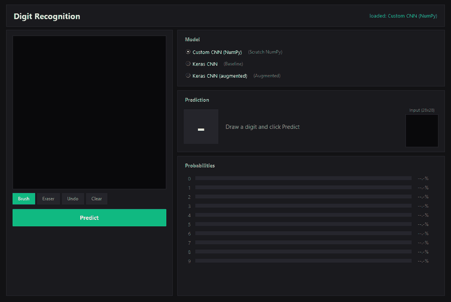

# Handwritten Digit Recognition: a CNN from Scratch in NumPy

A convolutional neural network written from scratch in NumPy, without any deep learning framework: the layers, backpropagation and optimizers are all implemented by hand. It reaches **98.94% test accuracy on MNIST** and is compared against two TensorFlow/Keras models. A desktop app lets you draw a digit with the mouse and see each model's prediction.

<p align="center">
  
</p>

## Highlights

- **`my_cnn`**: a small library with a Keras-like API (`Model.add`, `compile`, `fit`, `evaluate`, `save`) built only on NumPy.
- **Vectorized convolution**: the forward pass is a single matrix multiplication (im2col) and the backward pass scatters gradients back with col2im. There are no Python loops over pixels.
- **Comparison with Keras**: the same task solved with TensorFlow/Keras, with and without data augmentation (rotations + Gaussian noise), evaluated on the same validation and test sets.
- **Desktop app (Tkinter)**: the drawing is prepared the same way as the MNIST digits (cropped, scaled to fit a 20×20 box, centered by center of mass) before it goes to the model.

## How the From-Scratch CNN Works

### What is implemented

| Component | Details |
| :--- | :--- |
| `Convolution2D` | Same padding, stride, im2col forward pass (`sliding_window_view` + one matrix multiplication), col2im backward pass, He initialization |
| `MaxPooling2D` | Non-overlapping windows; caches the position of each maximum so the backward pass sends the gradient only there |
| `Dense` | Fully connected layer, He initialization |
| `Flatten`, `Rescaling`, `Input` | Helper layers |
| `ReLU`, `Softmax` | Activations (softmax subtracts the row maximum for numerical stability) |
| `CrossEntropy` | Loss, with the gradient computed together with softmax |
| `SGD`, `Momentum` | Optimizers |
| `Model` | Mini-batch training with shuffling every epoch and live progress, `predict`, `evaluate`, `save` / `load` |

All computations run in `float32`.

### API

The network trained in [`notebooks/mycnn.ipynb`](notebooks/mycnn.ipynb):

```python
import my_cnn
from my_cnn import layers

model = my_cnn.Model()
model.add(layers.Input((28, 28, 1)))
model.add(layers.Rescaling(1. / 255))
model.add(layers.Convolution2D(32, 3, activation_func='relu'))
model.add(layers.MaxPooling2D(2))
model.add(layers.Convolution2D(64, 3, activation_func='relu'))
model.add(layers.MaxPooling2D(2))
model.add(layers.Flatten())
model.add(layers.Dense(64, activation_func='relu'))
model.add(layers.Dense(10, activation_func='softmax'))

model.compile(optimizer='momentum', loss='crossentropy', learning_rate=0.02)
model.fit(x_train, y_train, epochs=2, batch_size=128)  # y_train is one-hot encoded
loss, accuracy = model.evaluate(x_test, y_test)
model.save('models/custom_cnn.pkl')
```

### The math

**Convolution as matrix multiplication (im2col).** Every $k \times k \times C$ patch of the zero-padded input becomes one row of the matrix $P$, and every filter becomes one row of $W$:

$$
Y = P W^{\top} + b, \qquad P \in \mathbb{R}^{(N \cdot H_{out} \cdot W_{out}) \times k^2 C}, \qquad W \in \mathbb{R}^{F \times k^2 C}
$$

**Backward pass.** With $\delta = \partial L / \partial Y$ flattened to $(N \cdot H_{out} \cdot W_{out}) \times F$:

$$
\frac{\partial L}{\partial W} = \delta^{\top} P, \qquad \frac{\partial L}{\partial b} = \sum_{\text{rows}} \delta, \qquad \frac{\partial L}{\partial P} = \delta W
$$

The rows of $\partial L / \partial P$ are then added back to the input positions they came from (col2im). Overlapping patches sum up.

**Softmax + cross-entropy.** Differentiating the two together gives a simple gradient with respect to the logits $z$ ($N$ = batch size), so the full softmax Jacobian is never needed:

$$
\frac{\partial L}{\partial z} = \frac{1}{N} \left( \hat{y} - y \right)
$$

**SGD with momentum** ($\beta = 0.9$, learning rate $\eta$):

$$
v \leftarrow \beta v + \nabla_W L, \qquad W \leftarrow W - \eta v
$$

## Model Results

| Model | Test Accuracy | Test Errors (of 10,000) | Validation Accuracy | Parameters | Training Images | Epochs | Training Time¹ |
| :--- | :---: | :---: | :---: | :---: | :---: | :---: | :---: |
| Keras CNN (Baseline) | 98.26% | 174 | 98.15% | 121,930 | 54,000 | 2 | ~10 s |
| Keras CNN (Augmented) | **99.36%** | **64** | 98.97% | 121,930 | 972,000 | 1 | ~50 s |
| Custom CNN (NumPy) | 98.94% | 106 | 98.58% | 220,234 | 162,000 | 2 | ~6.5 min |

¹ Duration of the `fit` call on a CPU (Intel Core i5-14600KF), no GPU.

**Most frequent mistakes on the test set** (true digit → predicted digit, number of cases):

| Keras CNN (Baseline) | Keras CNN (Augmented) | Custom CNN (NumPy) |
| :---: | :---: | :---: |
| 9 → 8 (20) | 4 → 9 (6) | 5 → 3 (9) |
| 7 → 2 (14) | 9 → 4 (5) | 9 → 7 (8) |
| 3 → 2 (11) | 8 → 9 (4), 7 → 2 (4) | 9 → 4 (8) |

All models use the same split of the MNIST training set: 54,000 images for training and 6,000 for validation (stratified). Augmentation is applied only to the training part. The 10,000-image MNIST test set is used only once, for the final evaluation. Every notebook sets a fixed seed (`SEED = 42`), so the results can be reproduced. Per-class precision, recall and confusion matrices are in the notebooks.

**Note: the models are not trained under identical conditions**, so the table shows how each setup performs, not which implementation is better. Other differences:

| | Keras CNN (Baseline) | Keras CNN (Augmented) | Custom CNN (NumPy) |
| :--- | :---: | :---: | :---: |
| Convolution padding | `valid` (28→26→13→11→5) | `valid` (28→26→13→11→5) | `same` (28→28→14→14→7) |
| Dropout | 0.3 | 0.3 | none |
| Optimizer | Adam (lr 0.001) | Adam (lr 0.001) | SGD + momentum (lr 0.02, β 0.9) |
| Batch size | 32 | 64 | 128 |
| Augmentation | none | rotations -20°…+20° (step 5°) + Gaussian noise, x18 | rotations -12°, 0°, +12°, x3 |

## What I Learned

- **Vectorization decides whether a NumPy network is usable.** My first convolution looped in Python over every output row, column and filter. Rewriting it as im2col with a single matrix multiplication, and col2im for the gradient, replaced those loops with array operations.
- **Backpropagation is mostly careful bookkeeping.** Each layer has to keep exactly what its backward pass needs: the input patches in `Convolution2D`, the positions of the maxima in `MaxPooling2D`. These caches also have to be cleared before saving, or the model file grows with data from the last batch.
- **Initialization matters.** I started with small random weights ($\mathcal{N}(0, 0.1^2)$) and random biases, then switched to He initialization with zero biases, the standard choice for ReLU networks.
- **Preprocessing is part of the model.** A digit drawn with a mouse looks different from an MNIST digit, so the app crops, scales and centers the drawing the same way MNIST was prepared before predicting.

## Built With

- **Python 3**: Core programming language.
- **NumPy**: Custom CNN implementation built from scratch.
- **TensorFlow / Keras**: Baseline and data-augmented deep learning models.
- **Tkinter & Pillow**: Desktop GUI interface and canvas image processing.
- **SciPy**: Center-of-mass image normalization and pre-processing.
- **Pandas, Scikit-learn, Matplotlib, Seaborn**: Evaluation metrics and data visualization.

## Getting Started

### Installation

1. Clone the repository:
   ```bash
   git clone https://github.com/bartek03m/digit-recognition.git
   cd digit-recognition
   ```

2. Create and activate a virtual environment:
   ```bash
   python -m venv .venv
   .venv\Scripts\Activate.ps1   # On Linux/macOS: source .venv/bin/activate
   ```

3. Install required dependencies:
   ```bash
   pip install -r requirements.txt
   ```

### Running the Application

Launch the interactive GUI:
```bash
python gui/gui.py
```

Draw a digit on the canvas using your mouse, choose a model (Custom NumPy CNN, Baseline Keras, or Augmented Keras), and click **Predict** to view classification results and confidence probabilities.

### Notebooks

| Notebook | Contents |
| :--- | :--- |
| [`mycnn.ipynb`](notebooks/mycnn.ipynb) | Training and evaluation of the custom NumPy CNN |
| [`recognition_without_augmentation.ipynb`](notebooks/recognition_without_augmentation.ipynb) | Keras CNN, baseline |
| [`recognition_with_augmentation.ipynb`](notebooks/recognition_with_augmentation.ipynb) | Keras CNN with rotations + Gaussian noise |
| [`final_doc_eng.ipynb`](notebooks/final_doc_eng.ipynb) | Full report: dataset analysis, pixel importance, augmentation, comparison and conclusions ([Polish version](notebooks/final_doc_.ipynb)) |

## License

Distributed under the MIT License. See `LICENSE` for more information.
